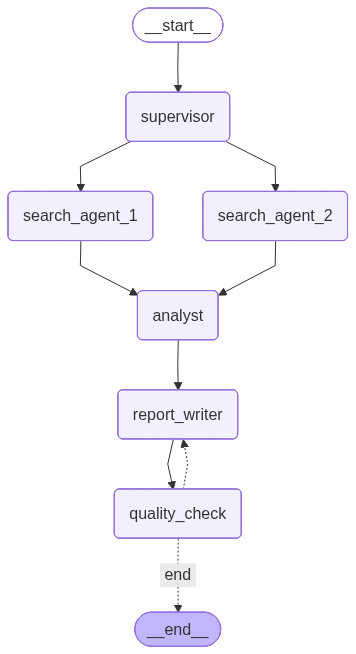

Research Agent
==============

Command-line, multi-agent research system using LangGraph.

* Uses an OpenAI model.
* Accepts the research topic as a command-line argument.
* Executes the research workflow through a LangGraph graph.
* Saves the final report to a Markdown file.
* Saves a detailed execution log containing all LLM interactions, tool calls,
  token usage, and cost information.

**Graph Architecture**



The workflow follows this graph structure:

1. **Supervisor**

The Supervisor is the first node in the graph.

- Receives the research topic.
- Plans the overall research strategy.
- Creates search tasks for two Search Agents.
- Sends the tasks to both Search Agents.

2. **Search Agents**

- Two agents run in parallel.
- Gather the necessary information from the web.
- Pass their results to the Analyst.

3. **Analyst**

- Synthesizes findings from both Search Agents.
- Passes the synthesized analysis to the Report Writer.

4. **Report Writer**

- Produces a structured report.
- Passes the report to Quality Check.

5. **Quality Check**

- Reviews and scores the report.
- If the score is insufficient, returns the result to the Report Writer for revision.
- Tracks revision cycles.
- Allows a maximum of 3 revision cycles.
- Must be the last node in the graph.

**State Management**

Blackboard for shared state tracking:

.. code:: python

   class ResearchState(TypedDict):
       messages: ...
       topic: str
       search_queries: list
       findings: list[dict]
       analysis: str
       report: str
       quality_score: float
       quality_feedback: str
       iteration: int

**Logging**

Writes a log file containing the complete
communication details with the LLM, including:

- Contents of input messages
- Contents of output messages
- Tool inputs
- Tool outputs
- Number of tokens
- Price

At the end of the log:

- Total number of tokens
- Total price

----

::

  from __future__ import annotations

  import argparse
  import json
  import operator
  import os
  import re
  from dataclasses import dataclass
  from datetime import datetime, timezone
  from pathlib import Path
  from typing import Annotated, Any, TypedDict

  from ddgs import DDGS
  from langchain_core.messages import AIMessage, BaseMessage, HumanMessage, SystemMessage
  from langchain_openai import ChatOpenAI
  from langgraph.graph import END, START, StateGraph
  from langgraph.graph.message import add_messages

Constants

::

  MIN_QUALITY_SCORE = 8.0
  MAX_REVISION_CYCLES = 3
  DEFAULT_MODEL = "gpt-5-mini"

.. class:: ResearchState(TypedDict)

::

  class ResearchState(TypedDict):
      messages: Annotated[list[BaseMessage], add_messages]
      topic: str
      search_queries: list[str]
      findings: Annotated[list[dict[str, Any]], operator.add]
      analysis: str
      report: str
      quality_score: float
      quality_feedback: str
      iteration: int

.. class:: Pricing
   
::

  @dataclass
  class Pricing:
      input_per_million_tokens: float
      output_per_million_tokens: float

.. class:: InteractionLogger

Collects a complete markdown audit trail for a research run, including tool
calls, LLM interactions, token usage totals, and estimated cost.

The logger writes the header immediately, then appends each logged section to
disk as soon as it is produced. Every appended section is also echoed to the
console so progress is visible during execution. It keeps running totals for
input tokens, output tokens, overall tokens, and price so ``finalize`` can
append a compact cost summary for the entire workflow.

:param file_path: Destination path for the markdown log file.
:param model: Model name recorded in each logged LLM interaction.
:param pricing: Pricing configuration used to summarize estimated cost.

::

  class InteractionLogger:
      def __init__(self, file_path: Path, model: str, pricing: Pricing) -> None:
          self.file_path = file_path
          self.model = model
          self.pricing = pricing
          self.total_input_tokens = 0
          self.total_output_tokens = 0
          self.total_tokens = 0
          self.total_price = 0.0
          self._add_header()

      def _add_header(self) -> None:
          started = datetime.now(timezone.utc).isoformat()
          header_lines = [
              "# Research Run Log\n",
              f"- Started (UTC): {started}\n",
              f"- Model: {self.model}\n",
              "- Pricing (per 1M tokens): "
              f"input=${self.pricing.input_per_million_tokens:.6f}, "
              f"output=${self.pricing.output_per_million_tokens:.6f}\n\n"
          ]
          self.file_path.parent.mkdir(parents=True, exist_ok=True)
          self.file_path.write_text("".join(header_lines), encoding="utf-8")

      def _append_and_print(self, text: str) -> None:
          with self.file_path.open("a", encoding="utf-8") as log_file:
              log_file.write(text)
          print(text, end="", flush=True)

      def log_tool_call(
          self,
          node_name: str,
          tool_name: str,
          tool_input: dict[str, Any],
          tool_output: Any,
      ) -> None:
          timestamp = datetime.now(timezone.utc).isoformat()
          log_text = "".join(
              [
                  f"## Tool Call - {node_name}\n",
                  f"- Time (UTC): {timestamp}\n",
                  f"- Tool: {tool_name}\n",
                  "- Tool Input:\n",
                  "```json\n",
                  f"{json.dumps(tool_input, indent=2, ensure_ascii=True)}\n",
                  "```\n",
                  "- Tool Output:\n",
                  "```json\n",
                  f"{json.dumps(tool_output, indent=2, ensure_ascii=True)}\n",
                  "```\n\n",
              ]
          )
          self._append_and_print(log_text)

      def log_llm_call(
          self,
          node_name: str,
          input_messages: list[BaseMessage],
          output_message: BaseMessage,
          usage: dict[str, int],
          price: float,
      ) -> None:
          timestamp = datetime.now(timezone.utc).isoformat()
          self.total_input_tokens += usage["input_tokens"]
          self.total_output_tokens += usage["output_tokens"]
          self.total_tokens += usage["total_tokens"]
          self.total_price += price

          log_text = "".join(
              [
                  f"## LLM Call - {node_name}\n",
                  f"- Time (UTC): {timestamp}\n",
                  f"- Model: {self.model}\n",
                  "- Input Messages:\n",
                  "```json\n",
                  f"{json.dumps([self._message_to_dict(msg) for msg in input_messages], indent=2, ensure_ascii=True)}\n",
                  "```\n",
                  "- Output Message:\n",
                  "```json\n",
                  f"{json.dumps(self._message_to_dict(output_message), indent=2, ensure_ascii=True)}\n",
                  "```\n",
                  "- Usage: "
                  f"input={usage['input_tokens']}, "
                  f"output={usage['output_tokens']}, "
                  f"total={usage['total_tokens']}\n",
                  f"- Estimated Price: ${price:.8f}\n\n",
              ]
          )
          self._append_and_print(log_text)

      def log_note(self, title: str, content: str) -> None:
          log_text = "".join([f"## {title}\n", f"{content}\n\n"])
          self._append_and_print(log_text)

      def finalize(self) -> None:
          ended = datetime.now(timezone.utc).isoformat()
          log_text = "".join(
              [
                  "## Totals\n",
                  f"- Ended (UTC): {ended}\n",
                  f"- Total Input Tokens: {self.total_input_tokens}\n",
                  f"- Total Output Tokens: {self.total_output_tokens}\n",
                  f"- Total Tokens: {self.total_tokens}\n",
                  f"- Total Estimated Price: ${self.total_price:.8f}\n",
              ]
          )
          self._append_and_print(log_text)

      @staticmethod
      def _message_to_dict(message: BaseMessage) -> dict[str, Any]:
          return {
              "type": message.type,
              "content": message.content,
              "additional_kwargs": message.additional_kwargs,
              "response_metadata": message.response_metadata,
          }

.. class:: LLMRunner

Thin wrapper around ``ChatOpenAI`` that centralizes model invocation,
token-usage extraction, and per-call price estimation for the research graph.

Instances of this class keep the selected model name, the active interaction
logger, and the pricing configuration together so every node can issue LLM
calls through a single consistent interface. The public ``invoke`` method
records each request and response, while the helper methods normalize token
usage metadata from the provider response and estimate the call cost.

:param model: OpenAI-compatible model name to use for all graph nodes.
:param logger: Logger that records message payloads, token counts, and cost.
:param pricing: Per-million-token pricing used for cost estimation.

::

  class LLMRunner:
      def __init__(self, model: str, logger: InteractionLogger, pricing: Pricing) -> None:
          self.model = model
          self.logger = logger
          self.pricing = pricing
          self.client = ChatOpenAI(model=model, temperature=0)

      def invoke(self, node_name: str, messages: list[BaseMessage]) -> AIMessage:
          response = self.client.invoke(messages)
          usage = self._extract_usage(response)
          price = self._estimate_price(usage)
          self.logger.log_llm_call(node_name, messages, response, usage, price)
          return response

      def _extract_usage(self, response: AIMessage) -> dict[str, int]:
          usage = getattr(response, "usage_metadata", None) or {}

          input_tokens = int(usage.get("input_tokens", 0))
          output_tokens = int(usage.get("output_tokens", 0))
          total_tokens = int(usage.get("total_tokens", input_tokens + output_tokens))

          if total_tokens == 0:
              metadata_usage = (response.response_metadata or {}).get("token_usage", {})
              input_tokens = int(metadata_usage.get("prompt_tokens", 0))
              output_tokens = int(metadata_usage.get("completion_tokens", 0))
              total_tokens = int(metadata_usage.get("total_tokens", input_tokens + output_tokens))

          return {
              "input_tokens": input_tokens,
              "output_tokens": output_tokens,
              "total_tokens": total_tokens,
          }

      def _estimate_price(self, usage: dict[str, int]) -> float:
          input_cost = (
              usage["input_tokens"] / 1_000_000
          ) * self.pricing.input_per_million_tokens
          output_cost = (
              usage["output_tokens"] / 1_000_000
          ) * self.pricing.output_per_million_tokens
          return input_cost + output_cost


.. function:: parse_json_block(text: str) -> dict[str, Any]

Parse a JSON object from raw model output, including common markdown-wrapped
variants produced by LLMs.

The parser first tries the full stripped text, then falls back to extracting a
fenced JSON block, and finally the first brace-delimited object it can find.
If none of those candidates decode to a JSON object, the function returns an
empty dictionary so downstream nodes can apply their own defaults.

:param text: Raw text returned by a model, potentially containing prose or
    markdown fences around a JSON object.
:returns: The first successfully decoded JSON object, or an empty dictionary
    if parsing fails.

::

  def parse_json_block(text: str) -> dict[str, Any]:
      stripped = text.strip()
      candidates: list[str] = [stripped]

      fenced_match = re.search(r"```(?:json)?\s*(\{.*?\})\s*```", stripped, flags=re.DOTALL)
      if fenced_match:
          candidates.append(fenced_match.group(1))

      brace_match = re.search(r"\{.*\}", stripped, flags=re.DOTALL)
      if brace_match:
          candidates.append(brace_match.group(0))

      for candidate in candidates:
          try:
              parsed = json.loads(candidate)
              if isinstance(parsed, dict):
                  return parsed
          except json.JSONDecodeError:
              continue

      return {}


.. function:: search_web(query: str, logger: InteractionLogger, node_name: str, max_results: int = 6) -> list[dict[str, str]]

Execute a DuckDuckGo text search and normalize the raw results into a small,
stable structure for the search agents.

The function records both the tool input and normalized output through the
interaction logger so the research run can be audited later. If the network
request or provider call fails, it returns a single synthetic result that
captures the error instead of raising, which lets the graph continue running.

:param query: Search phrase generated for the current research task.
:param logger: Run logger used to record the tool invocation and results.
:param node_name: Name of the graph node issuing the search.
:param max_results: Maximum number of results to request from DuckDuckGo.
:returns: A list of dictionaries with ``title``, ``url``, and ``snippet`` keys.

::

  def search_web(
      query: str,
      logger: InteractionLogger,
      node_name: str,
      max_results: int = 6,
  ) -> list[dict[str, str]]:
      tool_input = {"query": query, "max_results": max_results}
      results: list[dict[str, str]] = []

      try:
          with DDGS() as ddgs:
              raw_results = ddgs.text(query, max_results=max_results)
              for item in raw_results:
                  results.append(
                      {
                          "title": str(item.get("title", "")).strip(),
                          "url": str(item.get("href", "")).strip(),
                          "snippet": str(item.get("body", "")).strip(),
                      }
                  )
      except Exception as exc:  # pragma: no cover - network/runtime variability
          results = [
              {
                  "title": "Search Error",
                  "url": "",
                  "snippet": f"DDGS search failed: {exc}",
              }
          ]

      logger.log_tool_call(node_name, "duckduckgo_search", tool_input, results)
      return results


.. function:: build_graph(llm: LLMRunner, logger: InteractionLogger)

::

  def build_graph(llm: LLMRunner, logger: InteractionLogger):
      def supervisor_node(state: ResearchState) -> dict[str, Any]:
          topic = state["topic"]
          messages = [
              SystemMessage(
                  content=(
                      "You are the Supervisor in a research workflow. Create a concise research plan "
                      "and exactly two complementary web search queries. "
                      "Return strict JSON with keys: plan (string), search_queries (array of 2 strings)."
                  )
              ),
              HumanMessage(content=f"Research topic: {topic}"),
          ]

          response = llm.invoke("Supervisor", messages)
          parsed = parse_json_block(str(response.content))

          plan = str(parsed.get("plan", "Investigate the topic from complementary perspectives.")).strip()
          queries = parsed.get("search_queries", [])
          if not isinstance(queries, list):
              queries = []

          cleaned_queries = [str(q).strip() for q in queries if str(q).strip()]
          if len(cleaned_queries) < 2:
              cleaned_queries = [
                  f"{topic} latest developments",
                  f"{topic} expert analysis and statistics",
              ]

          final_queries = cleaned_queries[:2]

          return {
              "search_queries": final_queries,
              "messages": [AIMessage(content=f"Supervisor plan: {plan}")],
          }

      def make_search_node(node_name: str, query_index: int):
          def search_node(state: ResearchState) -> dict[str, Any]:
              topic = state["topic"]
              queries = state.get("search_queries", [])
              query = queries[query_index] if len(queries) > query_index else f"{topic} overview"

              web_results = search_web(query, logger, node_name)

              messages = [
                  SystemMessage(
                      content=(
                          "You are a Search Agent. Summarize the search results into clear factual findings. "
                          "Use concise bullet points and reference the source URLs where relevant."
                      )
                  ),
                  HumanMessage(
                      content=(
                          f"Topic: {topic}\n"
                          f"Query: {query}\n"
                          f"Search results (JSON):\n{json.dumps(web_results, indent=2, ensure_ascii=True)}"
                      )
                  ),
              ]

              response = llm.invoke(node_name, messages)
              summary = str(response.content).strip()

              finding = {
                  "agent": node_name,
                  "query": query,
                  "web_results": web_results,
                  "summary": summary,
              }

              return {
                  "findings": [finding],
                  "messages": [AIMessage(content=f"{node_name} completed query: {query}")],
              }

          return search_node

      def analyst_node(state: ResearchState) -> dict[str, Any]:
          topic = state["topic"]
          findings = state.get("findings", [])

          messages = [
              SystemMessage(
                  content=(
                      "You are the Analyst. Synthesize the two search-agent findings into one coherent "
                      "analysis. Highlight agreements, conflicts, confidence level, and key takeaways."
                  )
              ),
              HumanMessage(
                  content=(
                      f"Topic: {topic}\n"
                      f"Findings (JSON):\n{json.dumps(findings, indent=2, ensure_ascii=True)}"
                  )
              ),
          ]

          response = llm.invoke("Analyst", messages)
          analysis = str(response.content).strip()

          return {
              "analysis": analysis,
              "messages": [AIMessage(content="Analyst synthesized findings.")],
          }

      def report_writer_node(state: ResearchState) -> dict[str, Any]:
          topic = state["topic"]
          analysis = state.get("analysis", "")
          findings = state.get("findings", [])
          iteration = state.get("iteration", 0)
          quality_feedback = state.get("quality_feedback", "")

          if quality_feedback.startswith("[REVISION_GRANTED]"):
              quality_feedback = quality_feedback.replace("[REVISION_GRANTED]", "", 1).strip()

          revision_context = (
              "No prior revision feedback." if iteration == 0 else f"Revision cycle: {iteration}\nFeedback:\n{quality_feedback}"
          )

          messages = [
              SystemMessage(
                  content=(
                      "You are the Report Writer. Produce a polished markdown report with sections: "
                      "Title, Executive Summary, Key Findings, Analysis, Risks and Uncertainties, "
                      "Conclusion, and Sources."
                  )
              ),
              HumanMessage(
                  content=(
                      f"Topic: {topic}\n\n"
                      f"Synthesized analysis:\n{analysis}\n\n"
                      f"Findings JSON:\n{json.dumps(findings, indent=2, ensure_ascii=True)}\n\n"
                      f"Revision context:\n{revision_context}"
                  )
              ),
          ]

          response = llm.invoke("Report Writer", messages)
          report = str(response.content).strip()

          return {
              "report": report,
              "messages": [AIMessage(content="Report Writer produced report draft.")],
          }

      def quality_check_node(state: ResearchState) -> dict[str, Any]:
          topic = state["topic"]
          report = state.get("report", "")
          current_iteration = state.get("iteration", 0)

          messages = [
              SystemMessage(
                  content=(
                      "You are Quality Check. Evaluate the report and score quality from 0.0 to 10.0. "
                      "Return strict JSON with keys: score (number), feedback (string)."
                  )
              ),
              HumanMessage(
                  content=(
                      f"Topic: {topic}\n"
                      f"Current revision cycle count: {current_iteration}\n"
                      f"Report markdown:\n{report}"
                  )
              ),
          ]

          response = llm.invoke("Quality Check", messages)
          parsed = parse_json_block(str(response.content))

          raw_score = parsed.get("score", 0.0)
          try:
              score = float(raw_score)
          except (TypeError, ValueError):
              score = 0.0

          score = max(0.0, min(10.0, score))
          feedback = str(parsed.get("feedback", "No feedback provided.")).strip()

          can_revise = score < MIN_QUALITY_SCORE and current_iteration < MAX_REVISION_CYCLES
          updated_iteration = current_iteration + 1 if can_revise else current_iteration

          if can_revise:
              feedback = (
                  "[REVISION_GRANTED]\n"
                  f"Score below threshold ({MIN_QUALITY_SCORE}). "
                  f"Use revision cycle {updated_iteration} of {MAX_REVISION_CYCLES}.\n"
                  f"Quality feedback: {feedback}"
              )

          return {
              "quality_score": score,
              "quality_feedback": feedback,
              "iteration": updated_iteration,
              "messages": [AIMessage(content=f"Quality score: {score:.2f}")],
          }

      def route_after_quality_check(state: ResearchState) -> str:
          if state.get("quality_score", 0.0) >= MIN_QUALITY_SCORE:
              return "end"

          if state.get("quality_feedback", "").startswith("[REVISION_GRANTED]"):
              return "report_writer"

          return "end"

      builder = StateGraph(ResearchState)

      builder.add_node("supervisor", supervisor_node)
      builder.add_node("search_agent_1", make_search_node("Search Agent 1", 0))
      builder.add_node("search_agent_2", make_search_node("Search Agent 2", 1))
      builder.add_node("analyst", analyst_node)
      builder.add_node("report_writer", report_writer_node)
      builder.add_node("quality_check", quality_check_node)

      builder.add_edge(START, "supervisor")
      builder.add_edge("supervisor", "search_agent_1")
      builder.add_edge("supervisor", "search_agent_2")
      builder.add_edge("search_agent_1", "analyst")
      builder.add_edge("search_agent_2", "analyst")
      builder.add_edge("analyst", "report_writer")
      builder.add_edge("report_writer", "quality_check")
      builder.add_conditional_edges(
          "quality_check",
          route_after_quality_check,
          {
              "report_writer": "report_writer",
              "end": END,
          },
      )

      return builder.compile()


.. function:: get_pricing() -> Pricing

::

  def get_pricing() -> Pricing:
      input_per_million = float(os.getenv("GPT5_MINI_INPUT_PRICE_PER_1M", "0.250000"))
      output_per_million = float(os.getenv("GPT5_MINI_OUTPUT_PRICE_PER_1M", "2.000000"))
      return Pricing(
          input_per_million_tokens=input_per_million,
          output_per_million_tokens=output_per_million,
      )


.. function:: run(topic: str, output_path: Path, log_path: Path, model: str) -> None

::

  def run(topic: str, output_path: Path, log_path: Path, model: str) -> None:
      if not os.getenv("OPENAI_API_KEY"):
          raise RuntimeError("OPENAI_API_KEY is not set.")

      pricing = get_pricing()
      logger = InteractionLogger(log_path, model=model, pricing=pricing)
      llm = LLMRunner(model=model, logger=logger, pricing=pricing)
      graph = build_graph(llm, logger)

      # # visualize the graph
      # print("\n--- Mermaid Graph ---")
      # g = graph.get_graph()
      # png_bytes = g.draw_mermaid_png()
      # Path("_static/graph.png").write_bytes(png_bytes)
      # print("Image of the graph has been saved to _static/graph.png\n")
      # return

      initial_state: ResearchState = {
          "messages": [HumanMessage(content=f"Research topic: {topic}")],
          "topic": topic,
          "search_queries": [],
          "findings": [],
          "analysis": "",
          "report": "",
          "quality_score": 0.0,
          "quality_feedback": "",
          "iteration": 0,
      }

      final_state = graph.invoke(initial_state)

      quality_feedback = str(final_state.get("quality_feedback", "")).strip()
      if quality_feedback.startswith("[REVISION_GRANTED]"):
          quality_feedback = quality_feedback.replace("[REVISION_GRANTED]", "", 1).strip()

      final_report = str(final_state.get("report", "")).strip()
      final_report += "\n\n---\n"
      final_report += "## Quality Check Summary\n"
      final_report += f"- Final Score: {float(final_state.get('quality_score', 0.0)):.2f}/10\n"
      final_report += f"- Revision Cycles Used: {int(final_state.get('iteration', 0))}\n"
      final_report += f"- Feedback: {quality_feedback}\n"

      output_path.parent.mkdir(parents=True, exist_ok=True)
      output_path.write_text(final_report, encoding="utf-8")

      logger.log_note(
          "Run Result",
          (
              f"Output markdown file: {output_path}\n\n"
              f"Quality score: {float(final_state.get('quality_score', 0.0)):.2f}\n"
              f"Revision cycles used: {int(final_state.get('iteration', 0))}"
          ),
      )
      logger.finalize()


.. function:: parse_args() -> argparse.Namespace

::

  def parse_args() -> argparse.Namespace:
      parser = argparse.ArgumentParser(
          description="CLI multi-agent research system built with LangGraph."
      )
      parser.add_argument("topic", help="Research topic to investigate.")
      parser.add_argument(
          "--output",
          default="research_report.md",
          help="Output markdown file path (default: research_report.md).",
      )
      parser.add_argument(
          "--log",
          default="research_log.md",
          help="Detailed LLM/tool log file path (default: research_log.md).",
      )
      parser.add_argument(
          "--model",
          default=DEFAULT_MODEL,
          help=f"Model name (default: {DEFAULT_MODEL}).",
      )
      return parser.parse_args()


.. function:: main() 

::

  def main() -> None:
      args = parse_args()
      run(
          topic=args.topic,
          output_path=Path(args.output),
          log_path=Path(args.log),
          model=args.model,
      )
      print(f"Report saved to: {args.output}")
      print(f"Log saved to: {args.log}")


  if __name__ == "__main__":
      main()
